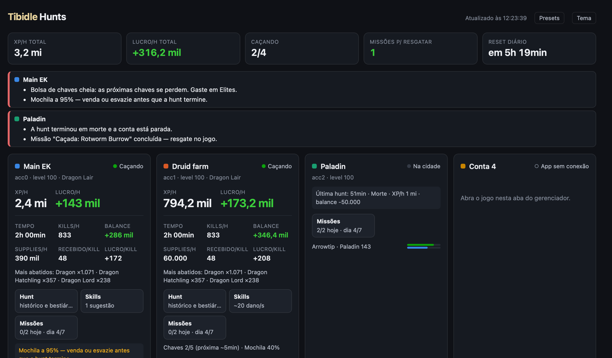

# Tibidle Multi-Manager para macOS

Aplicativo de comunidade para jogar [Tibidle](https://play.tibidle.com/) no macOS com quatro contas em uma janela, com uma **dashboard de hunts** que mostra o que cada conta está rendendo e o que dá para melhorar. Port nativo do [Tibidle Multi-Manager para Windows](https://github.com/danbatista/tibidle-multi-manager), feito em Swift, AppKit e WebKit (`WKWebView`), sem dependências externas.

**O app só lê o jogo.** Ele não clica, não envia comandos nem automatiza nada: você joga normalmente em cada aba, e a dashboard apenas observa o que o servidor manda para a página (veja [Como os dados são coletados](#como-os-dados-são-coletados)).

Cada pessoa entra com suas próprias contas diretamente no site do jogo. Não há assinatura nem serviço próprio do gerenciador. Código aberto sob a [licença MIT](LICENSE). Contato: flv.silva@yahoo.com.br



## Baixar e instalar

1. Baixe **TibidleMultiManager-macOS.dmg** na [última release](https://github.com/flvsilva/tibidle-multi-manager-macos/releases/latest).
2. Abra o DMG e arraste o app para **Aplicativos**.
3. Na primeira abertura o macOS bloqueia, porque o app não tem assinatura da Apple (Developer ID): clique em **OK**, vá em **Ajustes do Sistema → Privacidade e Segurança** e clique em **Abrir Mesmo Assim**. Pelo Terminal: `xattr -dr com.apple.quarantine "/Applications/Tibidle Multi-Manager.app"`.

**Atualizar:** quando sai uma versão nova, a dashboard mostra o link **Versão X disponível** no topo. Baixe o DMG novo e substitua o app em Aplicativos; logins, nomes e histórico ficam fora do app e são mantidos.

**Requisitos:** macOS 14 Sonoma ou mais recente, Apple Silicon ou Intel, e internet para jogar.

## Como usar

1. **Login:** abra cada aba e entre na conta desejada no site do jogo.
2. **Nome:** altere **Nome da conta** e clique em **Salvar nome** (ou Enter).
3. **Visualização:** **4 telas** mostra a grade 2 × 2; **Tela normal** amplia a conta selecionada (`⇧⌘G`).
4. **Ordem:** arraste uma aba sobre outra. A ordem é salva na hora e vale na grade da esquerda para a direita, de cima para baixo.
5. **Seleção:** use a aba, o título do bloco ou clique no jogo. Som (`⇧⌘M`) e Recarregar (`⌘R`) atuam na conta selecionada; `⌘1` a `⌘4` selecionam as posições atuais.
6. **Dashboard:** **Dashboard → Abrir dashboard** (`⇧⌘D`).

Também há zoom por conta (`⌘+`, `⌘-`, `⌘0`), tela cheia (`⌃⌘F`) e **Limpar sessão**, que apaga cookies e dados só daquele perfil. Cada aba tem seu próprio perfil de navegador (cookies e armazenamento isolados), e páginas ocultas continuam rodando em velocidade normal. Trocar de visualização ou reorganizar não recarrega as páginas. Fechar a janela encerra o aplicativo e mantém seus dados.

## Dashboard de hunts

Abra em **Dashboard → Abrir dashboard** ou, de outro aparelho na mesma rede (celular, tablet), pelo endereço mostrado na barra inferior do app, por exemplo `http://192.168.0.10:8787` (**Dashboard → Copiar endereço para a rede local**). Se o macOS perguntar se o app pode aceitar conexões de entrada, permita. A página atualiza sozinha.

### No topo

- **Resumo geral:** XP/h e lucro/h somados, contas caçando, missões a resgatar e tempo até o reset diário.
- **Precisa de atenção**, agrupado por conta:
  - missão pronta para resgatar, sequência semanal em risco, recompensa do calendário de login;
  - mochila ou bolsa de chaves cheia (chaves que caem com a bolsa cheia se perdem);
  - hunt que terminou por morte (com quem mais machucou no último minuto), sem gold ou com cap cheio; conta parada na cidade; sessão aberta em outro lugar;
  - invasão com inscrição aberta sem você ter entrado, ou começando em até 15 min;
  - lucro 20% abaixo da sua melhor hunt recente no mapa, com o setup mudado;
  - skill, wand ou rod de um elemento que os monstros resistem (menos de 50% do dano), com a arma que rende mais; membro com menos de 10% de mana em média;
  - **hunt arriscada:** alguém chegou a menos de 30% da vida, ou um golpe corpo a corpo leva 35% ou mais da vida do knight, com a criatura que mais machuca;
  - **risco de morte** de 5%/h ou mais (veja abaixo), com o membro mais exposto.
- **Ignorar avisos:** cada conselho de setup (elemento ou arma, mana, hunt arriscada, setup diferente da melhor hunt) tem **ignorar nesta hunt** ou **sempre**. Os ignorados saem do painel e das notificações e ficam listados embaixo, com **reativar**. Mudou a arma, o aviso volta, pois é outro aviso. Só funciona no dashboard aberto neste Mac.

### Cartão de cada conta

Status (caçando, na cidade, desconectada), XP/h, lucro/h, tempo, kills/h, balance, supplies/h, dano recebido e lucro por kill, monstros mais abatidos, **risco de morte**, chaves e mochila, e a party com HP/mana e a parte dos supplies de cada membro. Os botões do cartão abrem o **painel da conta** e já mostram o resumo de cada aba.

#### Risco de morte

A chance de alguém da party morrer na próxima hora, em `~X%/h`. É uma previsão, calculada com a vida real da party durante a hunt:

- a cada quadro (cerca de 3 s), o app guarda, por membro, a vida no começo da janela e quanto dela foi perdido até o fim, já descontada a cura (um knight pode levar 1600 em 3 s e curar quase tudo);
- cada janela é comparada com as que começaram com a vida parecida: com 40% de vida a party está sendo curada forte e quase nunca perde mais, as quedas grandes vêm de perto da vida cheia;
- as 10% maiores perdas dos últimos 20 minutos (os mais recentes pesam mais) ganham uma cauda de Pareto generalizada, que estima a chance de uma janela pior do que qualquer uma já vista, com um teto quando os dados mostram que o dano não passa muito de certo ponto;
- a chance de uma janela levar mais do que a vida que o membro tinha, somada por uma hora de janelas, é o risco ao vivo;
- esse número é juntado com o **histórico do mapa** perto do nível (mortes por hora de todas as contas): o ao vivo vale como 10 h de hunt, então um mapa com centenas de horas sem morte não vira alerta por um susto, e um mapa novo segue o que está acontecendo. Nos primeiros 10 minutos, só o histórico conta;
- cada hunt encerrada guarda o que a previsão esperava; depois de 10 hunts, a razão entre mortes vistas e previstas corrige o número (entre ¼ e 4×).

Acima de 5%/h o número fica amarelo e entra no painel de atenção; acima de 10%/h fica vermelho e gera notificação. A vida é lida a cada 3 s, então uma queda e uma cura dentro da mesma janela não aparecem: o risco de um golpe que mata mais rápido que isso fica subestimado.

### Painel da conta

- **Hunt:** a melhor hunt recente da conta nesse mapa (lucro/h de lá e de agora, o que mudou no setup de batalha, supplies por membro, botão para ver o setup completo e salvar como preset); o histórico das contas nesse mapa no nível atual ±2, para separar "é o nível" de "é o setup"; o bestiário do mapa com os marcos e o tempo até cada um; kills e drops.
- **Risco:** o risco de morte por membro (maior perda de vida em 3 s, vida mínima); os **momentos de perigo** da hunt, cada vez que alguém caiu abaixo de 40% da vida, com o horário, até onde caiu, quanto tempo levou para passar de 60% e as criaturas que mais bateram nos 15 s antes; e **cura e supplies**: cura feita contra o dano recebido e gold de supplies por 1.000 de dano recebido, comparado com a mediana e a melhor hunt do mapa perto do seu nível (30% acima do normal fica amarelo). Os momentos de perigo também ficam nos detalhes de cada hunt encerrada.
- **Nível:** XP que falta, tempo no ritmo atual e, nas hunts da conta perto desse nível, XP/h, lucro/h e o gold ganho ou gasto até subir; e **onde suas contas caçaram** no nível ±5 (qualquer conta, últimos 60 dias): XP/h, lucro/h e dano recebido/h por mapa, para as contas de trás seguirem as da frente.
- **Skills:** dano estimado de cada skill contra os monstros da hunt, avisos de elemento resistido e sugestões de troca com o ganho e o custo de mana (veja [Análise de skills](#análise-de-skills)).
- **Equipamento:** o dano recebido medido golpe a golpe, as melhorias de equipamento e o equipamento completo da party (veja [Conselheiro de equipamento](#conselheiro-de-equipamento)).
- **Missões:** as missões diárias, a previsão de quando cada uma conclui, se a hunt atual conta e a hunt sugerida; a sequência e as metas semanais.

### Comparações e histórico

- **Mesma hunt, lado a lado:** quando duas ou mais contas caçam no mesmo mapa, compara lucro, loot, supplies, XP, kills, dano causado e recebido, cura e as razões por kill e por XP; fica em vermelho o que está 20% ou mais pior que a melhor conta.
- **Ranking de hunts** por mapa: XP/h, lucro/h, kills/h, dano recebido/h, supplies/h e mortes, por conta ou todas, ordenado por lucro, XP, kills, menos dano ou menos supplies. Nas hunts com golpes medidos, a dica da coluna de dano mostra quanto foi dreno de vida.
- **Esta semana:** XP, lucro, tempo caçado, níveis, hunts e mortes de cada conta nos últimos 7 dias, com a variação em relação aos 7 anteriores.
- **Gráficos:** XP/h e lucro/h nas últimas 1 h a 7 dias, e lucro por nível em cada mapa (um ponto por hunt), com tabela.
- **Totais por dia** e **hunts encerradas** (duração, motivo, level, XP, loot, supplies, mortes). Clicar numa hunt mostra os detalhes, o setup de batalha com que ela rodou (comparado a outra hunt) e, se alguém morreu, **o último minuto antes da morte**: quem morreu, as criaturas que mais bateram, os elementos e quanto cada membro recebeu.
- **CSV** do histórico de hunts e das amostras por minuto.

### Análise de skills

O app combina as skills equipadas e os níveis de cada personagem (nível treinado mais o bônus de itens e bestiário), as fórmulas e elementos das magias (`https://play.tibidle.com/spells`) e as resistências de cada monstro abatido (`/bestiary/creature`, guardadas em `creatures-cache.json`). Com isso simula a rotação da party (a primeira skill da prioridade que está pronta e atende ao mínimo de criaturas) e estima o dano por segundo.

O dano é uma **estimativa**, porque o app não conhece as regras internas do servidor. Ele aprende com as suas hunts: ao fim de cada hunt iniciada com o app aberto, compara o dano previsto com o real e, com 3 hunts ou mais, aplica um fator de correção ("calibrado com N hunts"). Quando a mana média de um membro fica abaixo de 25%, as sugestões que gastam mais mana vêm com um aviso. Limitações: o jogo só informa o dano total da party, o ataque da arma pode não vir nos dados (assume 40) e buffs e resistências extras não entram no modelo.

### Conselheiro de equipamento

**Dano recebido medido.** Golpe a golpe, quanto do dano é corpo a corpo (golpes por segundo, média e máximo), quanto é magia de cada elemento (inclusive veneno, queimadura, sangramento e dreno de vida), em quem a magia cai e quais criaturas mais machucam. A medição vai também para o resumo de cada hunt.

**Melhorias.** Com o dano medido por membro, cada membro da party é avaliado contra o que ele recebe (o corpo a corpo cai só no knight; a magia, em quem ela atingiu); antes disso, só quem mais apanha (menor HP média, ou o knight) contra o dano da party. Cada slot de defesa é comparado com o melhor item que suas outras contas usam na mesma vocação (no jogo, item só exige vocação). O ganho é dado em **dano a menos por segundo**, pelas regras de combate da wiki:

- armadura tira em média 0,75 por ponto de cada golpe corpo a corpo;
- o escudo bloqueia 0,06 × (Escudo/4 + 2,23) × defesa, até 1 golpe por segundo;
- a proteção física age no golpe inteiro, e também no sangramento e na magia física;
- a magia só sente a proteção do elemento dela; dreno de vida não tem proteção.

Com 2 min e 20 golpes medidos, a divisão entre corpo a corpo e magia é a real; antes disso, uma divisão típica. A wand ou rod de sorcerer e druid é comparada com o elemento que os monstros da hunt resistem, indicando a de outra conta (ou o elemento) que rende mais. As até 4 trocas de maior impacto aparecem primeiro.

### Presets de batalha

O botão **Presets** abre a biblioteca local de configurações de batalha: skills em ordem de prioridade, mínimo de criaturas, curas, poção de mana, suportes e munição.

- **Salvar** guarda a configuração atual de um personagem com o nome da hunt (por exemplo "Dragon Lair · Druid").
- Cada preset vira um texto compacto (`tbp1.…`, com checksum) para copiar para outro Mac e colar em **Importar**; o conteúdo importado é higienizado e validado.
- **Ver passos** mostra as diferenças para a configuração atual de uma conta e o passo a passo para reproduzir no jogo.

O app **não aplica** nada no jogo. Salvar, importar, renomear e excluir só funcionam abrindo a dashboard neste Mac (`localhost`). A configuração é lida quando o jogo conecta; se você mudar no jogo, recarregue a aba antes de salvar.

### Notificações

O app avisa pelo macOS quando algo novo e importante entra no painel de atenção: missão pronta, sequência em risco, login a resgatar, invasão, mochila ou chaves cheias, hunt que acabou mal, hunt em que alguém chegou a menos de 15% da vida e risco de morte de 10%/h ou mais. Liga e desliga em **Dashboard → Notificar eventos importantes**. É local e só funciona no `.app` instalado.

## Privacidade e conexões

### Como os dados são coletados

Um script somente leitura (`Sources/TibidleCore/CollectorScript.swift`) roda apenas em `play.tibidle.com` e observa as mensagens que o jogo **recebe** do servidor pelo WebSocket. Ele não envia nada ao jogo e não toca nas mensagens enviadas, onde trafega a autenticação. Ao app ele repassa só uma lista fixa de campos:

- números da hunt (XP, loot, supplies, kills, dano, cura) e o status da party (vida, mana, level, skills com o bônus);
- as missões diárias, a sequência e as metas semanais (só progresso) e o horário da invasão do dia;
- do equipamento, por slot, o nome e os números do item e os nomes dos campos, nunca ids;
- dos golpes que a party recebe (eventos `mhit`, `mcast` e `death`), só a soma por criatura (pelo nome), por elemento e por posição na party (0 a 7), nunca ids de criaturas ou personagens.

O resto, inclusive o token de sessão, é descartado. Os testes em `Tests/TibidleCoreTests/DashboardTests.swift` executam esse script e verificam isso.

### Rede local

A dashboard não tem senha e, pela rede, é somente leitura: **qualquer pessoa na mesma rede** pode ver os dados de hunt (nomes dos personagens, levels, XP, gold) e os presets. Ela não expõe logins nem cookies e não permite ações no jogo. A única escrita, a biblioteca de presets, é aceita só de `localhost`. Use em redes de confiança.

### O que o app baixa

Tudo sem cookies nem login, com cópia local para funcionar offline:

| Endereço | Para quê | Frequência |
| --- | --- | --- |
| `play.tibidle.com/hunts` | Lista de hunts (missões e hunt sugerida) | a cada 12 h |
| `play.tibidle.com/spells` | Fórmulas das magias (análise de skills) | a cada 24 h |
| `play.tibidle.com/hunts/select` | Marcos do bestiário e monstros de cada mapa | a cada 24 h |
| `play.tibidle.com/bestiary/creature` | Resistências dos monstros abatidos | sob demanda |
| `api.github.com` (última release) | Aviso de versão nova; não baixa nem instala nada | 1 vez por dia |

### Dados das contas

Os dados ficam fora do repositório e do app:

```text
~/Library/Application Support/TibidleMultiManager/settings.json        # nomes, ordem, som e visualização
~/Library/Application Support/TibidleMultiManager/dashboard.sqlite     # histórico, presets e calibração
~/Library/Application Support/TibidleMultiManager/*-catalog.json, *-cache.json  # cópias dos dados públicos do jogo
~/Library/WebKit/io.github.flvsilva.tibidle-multi-manager/             # cookies e armazenamento dos 4 perfis
```

O histórico guarda amostras por minuto por 30 dias e todas as hunts encerradas. Os dados só são registrados com o app aberto; o período fechado aparece como "progresso offline".

O gerenciador não captura senhas: o site mantém a autenticação no perfil, como em um navegador comum. A pasta de perfis é privada e não deve ser compartilhada. Cada conta usa um identificador de perfil fixo (`ProfileIdentity` em `Sources/TibidleCore/Settings.swift`); renomear ou arrastar uma aba não altera esse identificador. **Não altere esses UUIDs**, ou os logins existentes deixam de ser encontrados.

## Limitações

- **Formato do jogo:** se o jogo mudar o formato das mensagens, a coleta pode parar até ser ajustada.
- **Estimativas:** dano de skills, ganho de equipamento, risco de morte e previsões de missão são estimativas a partir de dados públicos e das suas hunts; o app não conhece as regras internas do servidor.
- **Som:** o WebKit não tem API pública para silenciar uma página; o app usa a SPI `_setPageMuted:`. Se uma versão futura do macOS removê-la, o botão de som fica desativado.
- **Google, Discord ou CAPTCHA:** provedores podem impor restrições a navegadores embutidos. O app se identifica como Safari e abre os popups de login no mesmo perfil da conta, mas não automatiza essas etapas.
- **Login expirou:** o servidor pode pedir login de novo mesmo com o perfil salvo.
- **Memória:** são quatro páginas do jogo abertas ao mesmo tempo.

## Desenvolvimento

Requer as Command Line Tools do Xcode (`xcode-select --install`) ou o Xcode.

```sh
swift build                    # compila
swift test                     # testes (coletor, histórico, conselheiros, servidor…)
swift run                      # roda sem empacotar (prefira o .app: o bundle ID separa os perfis)
swift run DashboardPreview preview.png   # a dashboard com dados de exemplo (opções light e phone)
./scripts/build-app.sh         # gera dist/Tibidle Multi-Manager.app, o DMG e o ZIP (universal arm64 + x86_64)
./scripts/release.sh 1.2.3     # publica: com tudo commitado e enviado, roda os testes, gera os pacotes e cria a tag e a release no GitHub
```

O app é assinado *ad hoc* (sem Developer ID); um pacote baixado da internet precisa ser liberado como em [Baixar e instalar](#baixar-e-instalar).

| Arquivo | Responsabilidade |
| --- | --- |
| `Sources/TibidleCore/Settings.swift`, `TabOrder.swift`, `BrowserLayout.swift` | Configurações, identidades dos perfis, ordem e grade |
| `Sources/TibidleMultiManager/MainWindowController.swift` | Janela, abas, controles |
| `Sources/TibidleMultiManager/BrowserSession.swift`, `BrowserHostView.swift` | `WKWebView`, perfis, popups de login, som e posicionamento |
| `Sources/TibidleMultiManager/Theme.swift` | Cores, botões e arraste das abas |
| `Sources/TibidleMultiManager/Notifier.swift` | Notificações do macOS |
| `Sources/TibidleCore/CollectorScript.swift` | Coletor somente leitura injetado no jogo |
| `Sources/TibidleCore/DashboardStore.swift` | Estado ao vivo e histórico (SQLite) |
| `Sources/TibidleCore/DashboardServer.swift`, `DashboardRouter.swift` | Servidor HTTP da rede local |
| `Sources/TibidleCore/DashboardPage.swift` | Página da dashboard |
| `Sources/TibidleCore/Attention.swift` | Painel "precisa de atenção" |
| `Sources/TibidleCore/HuntInsights.swift` | Comparação com a melhor hunt recente |
| `Sources/TibidleCore/SkillModel.swift`, `SkillDataLoader.swift` | Análise de skills e calibração |
| `Sources/TibidleCore/GearAdvisor.swift` | Dano recebido medido e conselheiro de equipamento |
| `Sources/TibidleCore/HuntCatalog.swift`, `HuntCatalogLoader.swift`, `MissionAdvisor.swift` | Lista de hunts e missões diárias |
| `Sources/TibidleCore/BestiaryAdvisor.swift`, `InvasionAdvisor.swift` | Bestiário da hunt e invasões |
| `Sources/TibidleCore/BattlePreset.swift` | Presets de batalha |
| `Sources/TibidleCore/UpdateChecker.swift` | Aviso de versão nova |
| `Sources/DashboardPreview/main.swift` | Pré-visualização com dados de exemplo |
| `scripts/build-app.sh`, `scripts/release.sh` | Pacotes e publicação |

## Licença e créditos

Código sob [MIT](LICENSE), derivado do projeto original de Windows, cujo aviso de copyright é preservado. Projeto de comunidade sem afiliação oficial com o Tibidle. Veja [os avisos de terceiros](THIRD_PARTY_NOTICES.md).
